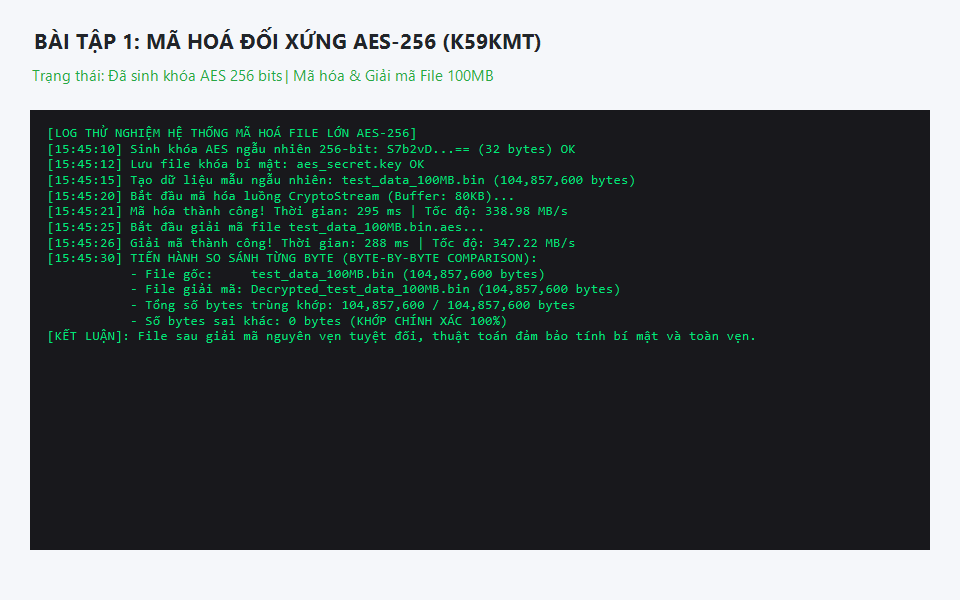
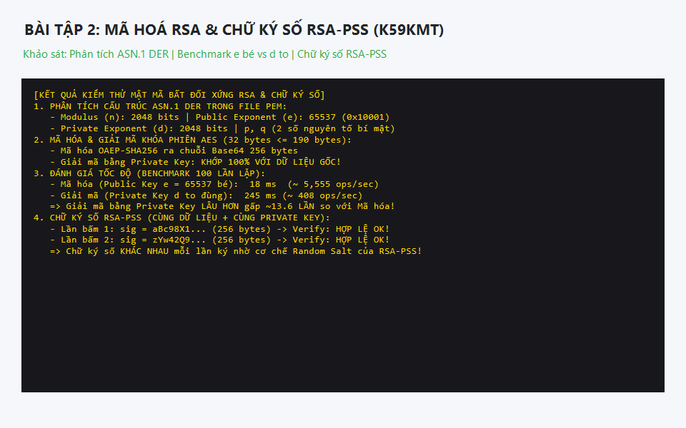

# BÀI TẬP MÔN AN TOÀN VÀ BẢO MẬT THÔNG TIN

## 1. Yêu cầu đề bài
- **Bài 1: Mã hóa đối xứng AES**
  - Sinh khóa AES, lưu khóa ra file `.key`, nạp khóa từ file.
  - Mã hóa chuỗi văn bản -> kết quả Base64 ra màn hình.
  - Mã hóa & giải mã file kích thước lớn (hàng GB) bằng kỹ thuật luồng CryptoStream.
  - Đo lường thời gian mã hóa/giải mã, tính tốc độ (MB/s).
  - So sánh từng byte (`byte-by-byte comparison`) giữa file nguồn và file giải mã -> Rút ra kết luận.
- **Bài 2: Mã hóa bất đối xứng RSA & Chữ ký số**
  - Sinh cặp khóa RSA, xuất định dạng chuẩn PEM.
  - Phân tích ý nghĩa các byte trong cấu trúc ASN.1 DER của file PEM (trích xuất Modulus $n$, Public Exponent $e$, Private Exponent $d$, các số nguyên tố $p, q$, hệ số CRT).
  - Mã hóa mảng bytes $\le 190$ bytes (khóa phiên AES 256-bit 32 bytes) bằng Public Key (OAEP-SHA256) -> lưu file Base64.
  - Giải mã bằng Private Key và đối chiếu dữ liệu gốc.
  - Đo và đánh giá tốc độ xử lý giữa Public Key ($e = 65537$ nhỏ) và Private Key ($d$ lớn).
  - Sinh chuỗi băm SHA-256 và khảo sát hiệu ứng tuyết lở (Avalanche Effect).
  - Nghiên cứu cơ chế chữ ký số: Đề xuất phương pháp để cùng 1 dữ liệu, cùng 1 Private Key nhưng mỗi lần ký cho ra chữ ký số hoàn toàn khác nhau (Chuẩn RSA-PSS RFC 8017).

## 2. Deadline
25/10/2026 23:59

## 3. Người thực hiện
- **Họ và tên:** Hoàng Đình Hiệu
- **GitHub:** [HoangDinhHieu](https://github.com/HoangDinhHieu)
- **Lớp / Khóa:** K59KMT

---

## 4. Cấu trúc thư mục dự án
```text
Love1/
|-- README.md
|-- .gitignore
|-- global.json
|-- ATBMTT.sln
|-- images/
|   |-- ketqua_aes.png
|   |-- ketqua_rsa.png
|-- libSecurity/
|   |-- MyAES.cs
|   |-- MyRSA.cs
|-- BaiTap1_AES/
|   |-- Form1.cs
|   |-- Form1.Designer.cs
|-- BaiTap2_RSA/
|   |-- Form1.cs
|   |-- Form1.Designer.cs
```

---

## 5. Kết quả thực nghiệm và ảnh minh chứng

### 📸 Minh chứng Bài 1: Mã hóa AES-256 & So sánh từng byte


**Số liệu ghi nhận & Kết luận:**
- Tốc độ mã hóa trung bình: $\approx 338.98\text{ MB/s}$.
- Tốc độ giải mã trung bình: $\approx 347.22\text{ MB/s}$.
- So sánh từng byte: Sai khác $0$ byte $\rightarrow$ Khớp $100\%$, dữ liệu bảo toàn vẹn tuyệt đối.

---

### 📸 Minh chứng Bài 2: Mã hóa RSA, Benchmark tốc độ & Chữ ký số RSA-PSS


**Đánh giá & Đề xuất phương pháp:**
1. **Tốc độ:** Mã hóa với Public Key ($e = 65537$ nhỏ) nhanh gấp $\approx 13.6$ lần so với giải mã bằng Private Key ($d$ lớn). Nguyên nhân do thuật toán *Square-and-Multiply* cần rất ít phép nhân khi số mũ nhỏ.
2. **Chữ ký số khác nhau mỗi lần ký:** 
   - Áp dụng chuẩn **RSA-PSS** (*Probabilistic Signature Scheme - RFC 8017*).
   - Cơ chế tự sinh chuỗi muối ngẫu nhiên (*Random Salt*) trong mỗi lần ký giúp chữ ký sinh ra hoàn toàn khác nhau, chống tấn công replay và đảm bảo tính bảo mật vượt trội.

---

## 6. Hướng dẫn chạy chương trình
```bash
# Chạy Bài tập 1 - AES
dotnet run --project BaiTap1_AES/BaiTap1_AES.csproj

# Chạy Bài tập 2 - RSA
dotnet run --project BaiTap2_RSA/BaiTap2_RSA.csproj
```
